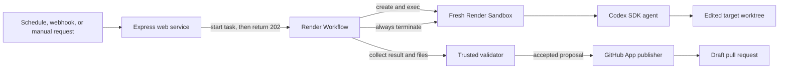

# Event-to-PR

This document is a self-contained architecture and implementation guide for a
system that turns an external event into a validated draft pull request. It is
written for a coding agent building the system from an empty TypeScript
repository.

The reference stack is:

- Node.js and TypeScript
- Express
- Render Workflows
- Render Sandboxes
- the OpenAI Codex SDK (`@openai/codex-sdk`)
- GitHub Apps and the GitHub API

Render Workflows and Sandboxes are evolving products. Before writing integration
code, inspect the installed `@renderinc/sdk` types and current Render
documentation. Before writing agent code, inspect the installed
`@openai/codex-sdk` types and current OpenAI documentation. Do not rely on
remembered beta API signatures.

## How a coding agent should use this guide

Do not start implementation by guessing the user's repositories, event format,
or definition of a valid change. First inspect the current repository for
answers, then run the discovery interview below.

Ask only questions that remain unanswered after inspection. Ask them in small
batches, explain any consequential tradeoff, and propose the documented
default when the user has no preference. Do not ask the user to choose internal
module names or other reversible implementation details.

Discovery is repository-first, not a questionnaire. The user identifies the
job, repositories, event source, and operational owner; the coding agent
inspects code, configuration, CI, and current provider documentation to derive
the implementation details.

Before writing application code:

1. collect the required decisions;
2. write an implementation brief using the template below;
3. label assumptions and deferred features explicitly;
4. ask the user to confirm the brief; and
5. implement only after the critical fields are known.

### Discovery interview

#### Round 1: Job and repositories

Establish:

- What task should the agent perform on every run?
- What observable condition means a change is required?
- What should produce `no_changes`?
- What situations should make the agent return `blocked` instead of guessing?
- What is the target repository and base branch?
- Are there additional source repositories the agent may read?

Default to one writable target repository. If the task needs to modify multiple
repositories, define separate jobs and PRs unless the user explicitly needs
cross-repository atomicity.

After the repositories are known, inspect them before asking implementation
questions. Determine:

- languages, runtime versions, package managers, and lockfiles;
- existing `AGENTS.md`, contribution guidance, and repository-local skills;
- setup and dependency-install commands;
- test, lint, type-check, build, and other CI commands;
- default branch and repository visibility;
- whether the task needs data not present in the repositories or event; and
- package registries or other network dependencies required during setup.

Summarize the inferred setup and verification plan for confirmation. Ask the
user only about ambiguities or requirements the repositories cannot answer.

#### Round 2: Event contract

Establish:

- Which system and trigger send the event: webhook provider, Render cron, or
  manual tool?
- Which event facts does the task need that are not available in the
  repositories?
- Does the caller need only `202 Accepted`, or also a callback or status API?

Inspect the sender's current documentation to identify its authentication
scheme, stable delivery ID, retry behavior, payload shape, and size limits.
Present the derived event contract for confirmation. Default to the sender's
native webhook signature when one exists. For cron or manual invocation,
default to an HMAC-signed request. Do not invent a random event ID on receipt;
retries need the same ID.

#### Round 3: Agent behavior and unresolved policy

Establish:

- Does the repository inspection leave any setup or verification ambiguity?
- What task-specific prompt or skill is not already present in the repository?
- What model, timeout, and approximate spend limit should apply?
- Are private package registries or additional network hosts required?
- Are there organization-specific rules that are not encoded in the
  repositories?

The application does not maintain a configurable editable-path allowlist.
Codex works in the target repository, and the resulting PR exposes its complete
diff for review. Keep malformed-path, proposal-size, credential, verification,
and draft-only publication checks.

#### Round 4: GitHub and Render operations

Establish:

- Are all repositories public, private, or mixed?
- Is a GitHub App already available, and where is it installed?
- Which Render workspace and region will own the services?
- Are Workflows and Sandboxes enabled there?
- Who will configure production secrets?
- What branch prefix, PR title, and reviewer or label conventions are needed?
- Can two events for the same task run concurrently?
- Where should operators inspect outcomes and failures?

Inspect existing GitHub App and Render configuration with available tools
before asking the user for values that are already configured.

Default to draft PRs, no automatic merge, a fresh Sandbox per run, no
whole-workflow retry, and the Render Dashboard as the first-version run UI.

### Critical decisions versus defaults

Do not implement until these are known:

- job objective and `no_changes` behavior;
- target repository and base branch;
- event source, authentication method, and stable event ID;
- a confirmed setup and verification plan derived from repository inspection;
- repository visibility and GitHub App access; and
- the person or team responsible for configuring Render and OpenAI secrets.

The following can use first-version defaults if the user accepts them:

- Node.js 22 and TypeScript;
- Express, Render Workflows, Render Sandboxes, and the Codex SDK;
- a 256 KB maximum event body;
- one fresh Sandbox and one Codex turn;
- a ten-minute Sandbox timeout;
- 20 changed files, 1 MB per file, and 5 MB total;
- deterministic `automation/<taskId>/<jobId-prefix>` branches;
- draft PRs with no automatic merge; and
- no database, callback, repair round, or snapshot cache.

### Stop and redesign when

Do not force the reference architecture onto a materially different job. Pause
and revise the brief when:

- one logical change must update multiple target repositories atomically;
- the event source cannot provide a stable retry-safe ID;
- the caller needs a synchronous result instead of an asynchronous `202`;
- repositories require different GitHub App installations;
- verification needs production credentials or access to private production
  systems;
- the expected runtime, disk, or output approaches current Workflow or
  Sandbox limits;
- the automation must continue updating a branch after humans add commits; or
- the requested endpoint is automatic approval or merge instead of a draft PR.

### Implementation brief template

Present this completed brief to the user before coding:

```markdown
# Event-to-PR implementation brief

## Job
- Task ID:
- Objective:
- Change required when:
- `no_changes` when:
- `blocked` when:

## Repositories
- Target repository:
- Base branch:
- Read-only source repositories and refs:
- Public/private:
- Repository instructions discovered:
- Runtime and package manager:
- Setup commands inferred from repository:
- Verification commands inferred from repository and CI:
- Required registries or network dependencies:

## Event
- Sender:
- Trigger:
- Authentication:
- Stable event ID:
- Allowed event data:
- Maximum body size:
- Response/status requirement:

## Agent
- Prompt or skill:
- Model:
- Timeout and spend limit:

## Proposal limits
- File-count and byte limits:
- Additional organization-specific constraints:

## Publication
- GitHub App and installation:
- Branch prefix:
- PR title/body convention:
- Labels/reviewers:

## Render operations
- Workspace:
- Workflows/Sandboxes access confirmed:
- Secret owner:
- Concurrency expectation:
- Outcome location or callback:

## Assumptions and deferred features
- Assumptions:
- Deferred:
- Open blockers:
```

If a user supplies multiple task types, complete the event and infrastructure
sections once, then complete the job, repository, agent, proposal, and
publication sections for each task.

## 0. System description

### What it is

Event-to-PR is an event-driven software-maintenance system. It receives an
authenticated event from a source system, starts a durable Workflow, runs a
coding agent in a fresh Sandbox containing the required repositories, validates
the proposed changes, and opens a draft pull request for human review.

The system is a reusable execution pattern. A
"freshness agent" that updates stale product demos is one task configuration.
The same system can run documentation maintenance, dependency updates,
repository migrations, or other bounded coding tasks by changing trusted task
configuration and the system prompt.

### What it does

For each accepted event, the system:

1. selects a predefined task;
2. resolves the configured repositories to exact commits;
3. starts a Render Workflow run;
4. creates a fresh Render Sandbox;
5. clones and prepares the repositories in that Sandbox;
6. runs Codex with a task-specific prompt;
7. executes configured verification commands;
8. collects the complete proposed file changes;
9. validates those changes outside the agent process;
10. creates or updates one deterministic draft pull request; and
11. terminates the Sandbox.

### Why it exists

Repository agents often need durable orchestration when a schedule, 
webhook, or person asks them to work.

This design separates those concerns:

- the **web service** handles short-lived external requests;
- the **Workflow** owns durable orchestration and retries;
- the **Sandbox** supplies isolated, on-demand compute for repository and
  model-directed code;
- the **agent** proposes changes; and
- trusted **validation and publishing code** decides what reaches GitHub.

## 1. System architecture

### 1.1 Deployment topology

Deploy two Render services from the same repository:

1. **Event web service** — an Express web service that authenticates an
   incoming request, converts it to a small `JobRequest`, starts the Workflow
   asynchronously, and returns `202 Accepted`.
2. **Workflow service** — a Render Workflow service that resolves repository
   state, manages the Sandbox, invokes the agent, validates its output, and
   publishes to GitHub.

A scheduler is an external event source, not a third control plane. A Render
cron job can call the authenticated web endpoint on a schedule. Webhooks and
manual tools call the same endpoint.

Define the web service, Workflow service, and optional cron trigger together in
`render.yaml`. Render Blueprints support Workflow services with
`type: workflow`. Workflow preview environments and Blueprint replication may
still have limitations, so verify those features against current documentation
if the implementation needs them.



### 1.2 Trust boundaries

Keep these boundaries even in the simple version:

1. **Events select tasks, not authority.** An event may provide a `taskId`,
   stable event ID, timestamp, and bounded task data. It must not supply
   repository URLs, branches, prompts, setup commands, verification commands,
   or PR destinations. Those values come from trusted application configuration
   or the inspected repository.
2. **The Sandbox cannot publish.** It may receive a short-lived,
   repository-scoped read token and a dedicated OpenAI API key. It must never
   receive the GitHub token used to create commits, branches, or pull requests.
3. **Agent output is a proposal.** Do not trust the agent's summary or claimed
   file list as proof of what changed. Collect the worktree state after the
   agent exits, then validate it in Workflow code.
4. **Repository code runs only in a Sandbox.** Clone, install, agent, build,
   test, and lint commands run in the isolated environment. The web service
   does none of this.
5. **Publishing stops at a draft PR.** The system does not approve, mark ready,
   merge, or bypass branch protection.

### 1.3 Suggested implementation directory

Use this as the default structure. Keep modules small, but do not create an
abstraction for every SDK call.

```text
.
├── src/
│   ├── contracts.ts              # JSON-serializable boundary types and schemas
│   ├── config/
│   │   └── tasks.ts              # Closed, trusted task catalog
│   ├── web/
│   │   └── server.ts             # Express health check and event endpoint
│   ├── workflows/
│   │   ├── index.ts              # Workflow task registration entry point
│   │   └── event-to-pr.ts        # End-to-end orchestration
│   ├── sandbox/
│   │   ├── run-agent.ts          # Create, prepare, execute, collect, terminate
│   │   └── collector.ts          # Produce ChangeBundle from the target worktree
│   ├── validation/
│   │   └── proposal.ts           # Enforce bundle integrity, size, and result policy
│   ├── github/
│   │   ├── auth.ts               # Mint short-lived GitHub App tokens
│   │   └── publish.ts            # Create commit, branch, and draft PR
│   └── lib/
│       └── ids.ts                 # Stable job, branch, and marker generation
├── prompts/
│   └── <task-id>.md              # Versioned prompt for each configured task
├── docs/
│   └── event-to-pr-implementation.md  # Confirmed non-secret implementation brief
├── tests/
│   ├── web.test.ts
│   ├── validation.test.ts
│   ├── workflow.test.ts
│   └── publish.test.ts
├── package.json
├── tsconfig.json
├── render.yaml                   # Web, Workflow, and optional cron services
└── README.md                     # Operator commands and deployed service IDs
```

Dependency direction should remain simple:

```text
web -> contracts, config, workflow client
workflow -> contracts, config, sandbox, validation, github
sandbox -> contracts, Render SDK
validation -> contracts
github -> contracts, GitHub client
```

The web module must not import Sandbox or publishing code. Sandbox code must
not receive GitHub write credentials.

### 1.4 End-to-end flow

#### Step 1: Receive and authenticate the event

Expose a narrow endpoint such as:

```text
POST /v1/events/:taskId
```

The handler must:

1. cap the raw request body size;
2. authenticate the caller before acting on the body;
3. validate `taskId` against the configured task catalog;
4. require a stable external `eventId`;
5. discard unknown fields rather than treating them as configuration;
6. assign a trusted source ID from the authenticated adapter;
7. derive
   `jobId = sha256(taskId + "\0" + source + "\0" + eventId)`;
8. start the Workflow without waiting for completion; and
9. return `202` with `jobId` and the Render run ID.

Use the sender's native signature scheme for a real webhook. A cron or manual
caller can use an HMAC signature or a dedicated bearer secret over TLS.

The stable job ID does not necessarily prevent duplicate Workflow compute if
the same event is delivered concurrently. It does ensure duplicate runs target
the same automation branch and PR. If preventing duplicate compute later
becomes important, add a durable claim store; do not pretend an in-memory map
provides idempotency across web-service instances.

#### Step 2: Resolve trusted task configuration

The Workflow parses `JobRequest`, loads `TaskConfig` by `taskId`, and rejects
unknown tasks. It resolves the target base branch and every source ref to full
commit SHAs once. All later steps use those SHAs.

Task data from the event may describe the event—for example, an asset ID or a
release number—but cannot override task configuration.

#### Step 3: Create and prepare a fresh Sandbox

Create one Sandbox with:

- an explicit lifetime shorter than the Workflow timeout;
- only the environment values required by setup and the agent;
- outbound network access limited as narrowly as the chosen setup permits;
  and
- enough CPU, memory, and disk for the repositories and verification commands.

Wait until the Sandbox reports `running` before executing commands.

Mint a short-lived GitHub App installation token restricted to configured
repositories and `contents: read`. Use it only to clone exact commits. Do not
put credentials in clone URLs, command arguments, logs, Git remotes, or files
that the agent can read. Remove the credential helper and token after cloning.

Prepare a predictable filesystem:

```text
/workspace/target/       writable target repository at the resolved base SHA
/workspace/sources/...   read-only source repositories at resolved SHAs
/workspace/input/        bounded event data and generated agent input
/workspace/output/       structured result and collected change bundle
```

Install or upload the pinned agent runtime, then run only the setup commands
from trusted `TaskConfig`. Record tool versions in the final outcome. Dynamic
setup is acceptable in version one; snapshots are an optimization to add only
after the uncached path works reliably.

#### Step 4: Run Codex

Run `@openai/codex-sdk` inside the Sandbox, with `/workspace/target` as the
working directory and workspace-write permissions. Build the prompt from:

- the versioned task prompt selected by `TaskConfig.agent`;
- `AgentInput`;
- the locations and pinned commits of source repositories;
- the objective and verification commands the agent may run while iterating;
  and
- the required `AgentResult` JSON shape.

The agent may inspect source repositories and edit the target worktree. It may
not publish, change task policy, or choose a different repository.

Capture streamed output for debugging, but cap retained log bytes and redact
known secrets. Require one final structured result. Treat malformed output as a
failed job, not as permission to infer what the agent meant.

The OpenAI key exists inside the Sandbox while Codex runs. Use a dedicated,
spend-capped project key and document this residual exposure.

#### Step 5: Verify and collect

After Codex exits:

1. remove the OpenAI key from subsequent command environments where the SDK
   permits;
2. run each configured verification command in the target repository;
3. stop immediately if a required command fails;
4. inspect tracked, deleted, and untracked paths relative to the pinned base
   commit;
5. reject symlinks, submodules, and unsupported file modes;
6. write complete contents for added or modified files into `ChangeBundle`;
   and
7. download `AgentResult`, `ChangeBundle`, and verification results to the
   Workflow.

The collector is infrastructure, not an agent tool. Store it outside the
writable target worktree and invoke it only after the agent process exits.

#### Step 6: Validate the proposal

Trusted Workflow code validates:

- the bundle's base commit equals `ResolvedJob.target.commit`;
- every collected path is a normalized Git tree path from the target
  repository and contains no traversal;
- file count, per-file bytes, and total bytes stay within policy;
- decoded content length and Git blob hashes are correct;
- the collected file set matches the agent's `changed` result;
- `no_changes` and `blocked` results have an empty bundle; and
- all required verification commands passed.

Validation failure produces a terminal rejected outcome and no GitHub write.
Do not add an automatic agent repair loop in version one.

#### Step 7: Publish one draft PR

Only after validation succeeds, mint a new GitHub App token with target
repository write access. Keep it in Workflow memory and never send it to the
Sandbox.

Use the GitHub Git Data and Pull Request APIs to:

1. create blobs from validated file contents;
2. create a tree based on the pinned target commit;
3. create a commit with `jobId` in the commit message;
4. create or update
   `automation/<taskId>/<first-12-characters-of-jobId>`;
5. find or create a draft PR into the configured base branch; and
6. include `<!-- event-to-pr:<jobId> -->` in the PR body.

Before moving an existing automation branch, verify that its current commit was
created by this system for the same `jobId`. If a person has pushed another
commit to it, fail closed instead of overwriting their work.

Build the PR title and structure from trusted configuration. Escape and length
limit model-written summaries before placing them in the body. A
`no_changes`, `blocked`, failed, or rejected job performs no GitHub write.

#### Step 8: Record the outcome and clean up

Return one small `JobOutcome` containing IDs, status, commit SHAs, duration,
usage when available, and the PR URL when one exists. Do not return repository
contents or a full change bundle as a Workflow result.

Create the Sandbox inside a `try` block and terminate it in `finally`.
Termination must run for success, agent failure, validation failure,
publication failure, timeout, and cancellation. Also configure a provider
lifetime so a lost Workflow cannot leave the Sandbox running indefinitely.

Configure the parent Workflow task with no automatic retries. A retry of the
whole task can repeat model work. Add narrow, explicit retries only around
operations that are safe to repeat, such as Sandbox creation before Codex
starts or GitHub lookups and idempotent publication steps.

## 2. Core interfaces and data model

Implement runtime schemas for every external and cross-process boundary. Zod
is a reasonable TypeScript choice. The types below show the intended contract;
the implementation should add string lengths, array limits, URL rules, and
path validation.

```typescript
type JsonValue =
  | null
  | boolean
  | number
  | string
  | JsonValue[]
  | { [key: string]: JsonValue };

// Untrusted input accepted by the web service.
type EventRequest = {
  eventId: string;       // Stable ID from the sender, not generated randomly.
  occurredAt: string;    // ISO 8601.
  data?: JsonValue;      // Bounded event context, never configuration.
};

type JobRequest = {
  schemaVersion: 1;
  taskId: string;        // Selected by the bounded route and task catalog.
  source: string;        // Assigned by the authenticated adapter.
  jobId: string;         // SHA-256(taskId + NUL + source + NUL + eventId).
  event: EventRequest;
};

// Trusted application configuration. Events cannot override these values.
type TaskConfig = {
  id: string;
  objective: string;
  target: {
    owner: string;
    repo: string;
    baseBranch: string;
  };
  sources: Array<{
    owner: string;
    repo: string;
    ref: string;
  }>;
  agent: {
    promptPath: string;
    model?: string;
    timeoutSeconds: number;
  };
  setupCommands: Array<{
    name: string;
    command: string;
    timeoutSeconds: number;
  }>;
  verifyCommands: Array<{
    name: string;
    command: string;
    timeoutSeconds: number;
  }>;
  policy: {
    maxFiles: number;
    maxFileBytes: number;
    maxTotalBytes: number;
  };
  sandboxTimeoutSeconds: number;
  pullRequest: {
    title: string;
    bodyHeading: string;
  };
};

type ResolvedRepository = {
  owner: string;
  repo: string;
  commit: string;        // Full 40-character Git SHA.
  path: string;          // Absolute path inside the Sandbox.
};

// Immutable trusted state used for one run.
type ResolvedJob = {
  schemaVersion: 1;
  jobId: string;
  taskId: string;
  objective: string;
  target: ResolvedRepository & { baseBranch: string };
  sources: ResolvedRepository[];
  eventData?: JsonValue;
  agent: TaskConfig["agent"];
  setupCommands: TaskConfig["setupCommands"];
  verifyCommands: TaskConfig["verifyCommands"];
  policy: TaskConfig["policy"];
};

// The subset of job data the agent needs. No publication destination or token.
type AgentInput = {
  schemaVersion: 1;
  jobId: string;
  taskId: string;
  objective: string;
  target: ResolvedRepository;
  sources: ResolvedRepository[];
  eventData?: JsonValue;
  verifyCommands: TaskConfig["verifyCommands"];
};

type AgentResult =
  | {
      schemaVersion: 1;
      status: "changed";
      summary: string;
      changes: Array<{
        path: string;
        operation: "add" | "modify" | "delete";
        rationale: string;
      }>;
    }
  | {
      schemaVersion: 1;
      status: "no_changes";
      summary: string;
    }
  | {
      schemaVersion: 1;
      status: "blocked";
      summary: string;
      reason: string;
    };

type ChangeEntry =
  | {
      path: string;
      operation: "add" | "modify";
      mode: "100644" | "100755";
      bytes: number;
      blobSha: string;
      contentBase64: string;
    }
  | {
      path: string;
      operation: "delete";
    };

// Produced by the collector, not by trusting AgentResult.changes.
type ChangeBundle = {
  schemaVersion: 1;
  baseCommit: string;
  entries: ChangeEntry[];
  verification: Array<{
    name: string;
    passed: boolean;
    exitCode: number | null;
    outputTail: string;
  }>;
};

type JobOutcome =
  | {
      jobId: string;
      status: "pr_opened" | "pr_updated";
      targetCommit: string;
      sourceCommits: string[];
      pullRequestUrl: string;
      durationMs: number;
    }
  | {
      jobId: string;
      status: "no_changes" | "blocked" | "rejected" | "failed";
      targetCommit?: string;
      sourceCommits?: string[];
      reason: string;
      durationMs: number;
    };
```

### Data ownership

- The **event sender** owns only `eventId`, `occurredAt`, and bounded `data`.
- The **web service** authenticates the event and derives `jobId`.
- The **task catalog** owns repositories, refs, prompts, setup and verification
  commands, limits, timeouts, and PR presentation.
- The **Workflow** owns resolved commit SHAs and publication decisions.
- The **agent** owns its reasoning, summary, and proposed edits.
- The **collector** owns the observed changed-file bundle.
- **GitHub** owns the final commit, branch, and PR identifiers.

No database is required for version one. Render retains Workflow run state;
GitHub stores the durable publication state; deterministic IDs connect them.

## 3. Required setup

### 3.1 Accounts and access

You need:

1. a Render workspace with Render Workflows and Render Sandboxes enabled;
2. a Render API key and workspace ID;
3. a GitHub App installed on the repositories the tasks may access;
4. an OpenAI API project and key for Codex; and
5. a repository containing this application.

Use Node.js 22 for the application unless the current SDKs require a newer
version.

Install at least:

```text
@renderinc/sdk
@openai/codex-sdk
express
zod
octokit
minimatch
```

Add the normal TypeScript, test-runner, lint, and type packages as development
dependencies. Pin the Render and Codex SDK versions after confirming a working
combination.

### 3.2 GitHub App

Create a GitHub App with:

- repository metadata: read;
- repository contents: read and write; and
- pull requests: read and write.

Install it only on repositories used by configured tasks. At runtime, mint:

- a short-lived, repository-selected token reduced to `contents: read` for
  Sandbox cloning; and
- a separate short-lived token for target-repository publication.

The App's broad permission is not a reason to pass its publication token into
the Sandbox.

### 3.3 Environment variables

Configure secrets by service.

**Event web service**

```text
PORT
EVENT_SECRET
RENDER_API_KEY
WORKFLOW_SLUG
```

Bind Express to `0.0.0.0:$PORT`. Keep the endpoint stateless. `RENDER_API_KEY`
must be able to start the configured Workflow task but does not need GitHub or
Sandbox credentials. In the Blueprint, populate `WORKFLOW_SLUG` from the
Workflow service's `slug` property. The web service starts
`${WORKFLOW_SLUG}/event_to_pr`.

**Workflow service**

```text
RENDER_API_KEY
RENDER_WORKSPACE_ID
OPENAI_API_KEY
GITHUB_APP_ID
GITHUB_APP_INSTALLATION_ID
GITHUB_APP_PRIVATE_KEY
```

The Workflow uses Render credentials to manage Sandboxes. It uses the GitHub
App key to mint short-lived read and write tokens. It supplies only the
short-lived read token and the dedicated OpenAI key to Sandbox setup or agent
execution.

Do not place secrets in Workflow arguments, task results, repository config,
PR bodies, or logs. Render's filesystem is ephemeral; do not use local files
as durable state.

### 3.4 Render service creation

1. Run `render workflows init` with a current Render CLI to scaffold or verify
   the Workflow entry point.
2. Develop locally and confirm the `event_to_pr` task registers.
3. Push the application repository to a supported Git provider.
4. Define the Express service with `type: web` and the Workflow service with
   `type: workflow` in `render.yaml`. Add an optional `type: cron` trigger when
   needed.
5. Configure the web service's `WORKFLOW_SLUG` with a Blueprint
   `fromService` reference to the Workflow service's `slug` property. Keep the
   task name `event_to_pr` in application code.
6. Declare secret environment variables with `sync: false`, validate the
   Blueprint, and deploy it.
7. Confirm the Workflow registers
   `<workflow-service-slug>/event_to_pr`.
8. Add a health check and verify the web process listens on
   `0.0.0.0:$PORT`.
9. If configured, verify the cron job signs and sends an event to the web
   endpoint.

Workflow inputs and results must remain small and JSON-serializable. Transfer
change bundles directly through Sandbox download APIs, not through nested
Workflow task return values.

### 3.5 Implementation order

Build in this order and keep tests passing:

1. Complete and confirm `docs/event-to-pr-implementation.md`.
2. Define Zod schemas, `TaskConfig`, stable ID generation, and one local task.
3. Implement proposal validation and unit-test traversal, invalid Git paths,
   size limits, mismatched results, and failed verification.
4. Implement the publisher against a fake GitHub client; test retries,
   duplicate job IDs, draft-only behavior, and human-modified branches.
5. Implement Sandbox lifecycle behind an injected client and test cleanup on
   every exit path.
6. Add the Codex runner and collector, first with a fake agent and temporary
   local repositories.
7. Register the real Workflow task with whole-task automatic retry disabled.
8. Add the Express endpoint, authentication, request bounds, task lookup, and
   asynchronous Workflow start.
9. Run one live `no_changes` case and one intentional one-file change against
   a disposable repository.

### 3.6 Minimum acceptance checks

The implementation is ready for its first real task when all of these pass:

- invalid authentication starts no Workflow;
- unknown tasks and attempts to inject repository or command configuration are
  rejected;
- the same source and event ID derive the same job ID, while different sources
  with the same event ID do not collide;
- the web endpoint returns before agent work begins;
- repositories are checked out at recorded full commit SHAs;
- GitHub write credentials are absent from the Sandbox;
- a malformed or out-of-repository path, or a failed verification command,
  opens no PR;
- `no_changes` opens no PR;
- a valid one-file change opens a draft PR with the expected bytes;
- repeating the same event finds or updates the same automation PR;
- a human-modified automation branch is not overwritten;
- logs and outcomes contain no credential; and
- every execution path attempts Sandbox termination.

Once this path is reliable, optimize measured bottlenecks. Filesystem
snapshots are the likely first optimization when repository cloning and
dependency installation dominate run time, but they are not required for the
architecture to work.

### 3.7 Current documentation

Treat these as the source of truth for product setup and SDK behavior:

- [Render Workflows](https://render.com/docs/workflows)
- [Render Sandboxes](https://render.com/docs/sandboxes)
- [OpenAI Codex SDK](https://developers.openai.com/codex/sdk)
- [GitHub Apps](https://docs.github.com/en/apps)
